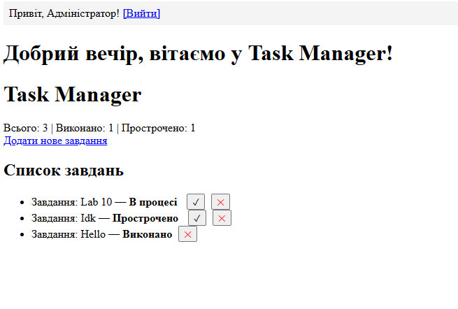
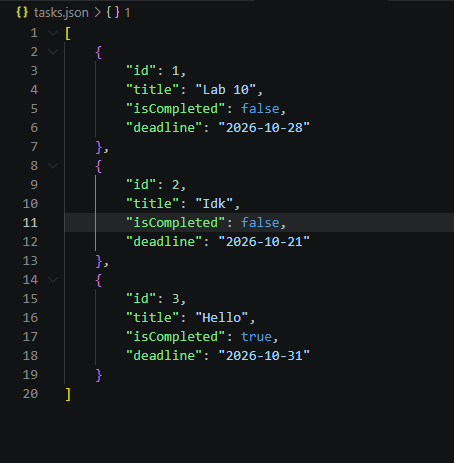

# Лабораторна робота №10


## 1. Фрагмент із Task.php
```php
<?php
declare(strict_types=1);

class Task
{
    public function __construct(
        public readonly int    $id,
        private string         $title,
        private bool           $isCompleted = false,
        private ?string        $deadline    = null,
    ) {
        if (empty(trim($title))) {
            throw new InvalidArgumentException('Назва завдання не може бути порожньою.');
        }
    }

    public function getId(): int { return $this->id; }
    public function getTitle(): string { return $this->title; }
    public function isCompleted(): bool { return $this->isCompleted; }
    public function getDeadline(): ?string { return $this->deadline; }

    public function isOverdue(): bool
    {
        if ($this->isCompleted || $this->deadline === null) {
            return false;
        }
        return strtotime($this->deadline) < time();
    }

    public function complete(): void { $this->isCompleted = true; }

    public function getStatusLabel(): string
    {
        if ($this->isCompleted) return 'Виконано';
        if ($this->isOverdue())  return 'Прострочено';
        return 'В процесі';
    }


// Перетворює об'єкт на звичайний масив для JSON-кодування
public function toArray(): array
{
    return [
        'id'          => $this->id,
        'title'       => $this->title,
        'isCompleted' => $this->isCompleted,
        'deadline'    => $this->deadline,
    ];
}

// Статичний метод: з масиву (прочитаного з JSON) створює об'єкт Task
public static function fromArray(array $data): self
{
    return new self(
        id:          $data['id'],
        title:       $data['title'],
        isCompleted: $data['isCompleted'] ?? false,
        deadline:    $data['deadline']    ?? null,
    );
}

}

```

* **Пояснення методів**
  __construct() — ініціалізує властивості нового завдання  і перевіряє, чи не є назва порожньою
  getId() — повертає унікальний ідентифікатор завдання
  getTitle() — повертає назву завдання
  isCompleted() — перевіряє, чи виконане завдання 
  getDeadline() — повертає дату дедлайну завдання або null, якщо її не задано
  isOverdue() — перевіряє, чи минув термін виконання завдання 
  complete() — змінює поточний статус завдання на виконаний
  getStatusLabel() — визначає і повертає текстовий статус для виведення на екран
  toArray() — перетворює об'єкт завдання на звичайний масив для подальшого збереження у форматі JSON
  fromArray() — створює новий об'єкт Task із масиву даних (використовується під час зчитування з файлу)

## 2. Фрагмент із TaskRepository.php
```php
<?php
declare(strict_types=1);

require_once __DIR__ . '/Task.php';

class TaskRepository
{
    /** @var Task[] */
    private array $tasks = [];

    public function __construct(private string $storageFile)
    {
        $this->load();
    }

    public function findAll(): array  { return $this->tasks; }

    public function findById(int $id): ?Task
    {
        foreach ($this->tasks as $task) {
            if ($task->getId() === $id) return $task;
        }
        return null;
    }

    public function add(string $title, ?string $deadline = null): Task
    {
        $task = new Task($this->generateNextId(), $title, false, $deadline);
        $this->tasks[] = $task;
        $this->save();
        return $task;
    }

    public function complete(int $id): bool
    {
        $task = $this->findById($id);
        if (!$task) return false;
        $task->complete();
        $this->save();
        return true;
    }

    public function delete(int $id): bool
    {
        foreach ($this->tasks as $key => $task) {
            if ($task->getId() === $id) {
                unset($this->tasks[$key]);
                $this->tasks = array_values($this->tasks);
                $this->save();
                return true;
            }
        }
        return false;
    }

    public function countCompleted(): int
    {
        return count(array_filter($this->tasks, fn(Task $t) => $t->isCompleted()));
    }

    public function countOverdue(): int
    {
        return count(array_filter($this->tasks, fn(Task $t) => $t->isOverdue()));
    }

    private function generateNextId(): int
    {
        if (empty($this->tasks)) return 1;
        return max(array_map(fn(Task $t) => $t->getId(), $this->tasks)) + 1;
    }

    private function load(): void
    {
        if (!file_exists($this->storageFile)) { $this->tasks = []; return; }
        $data = json_decode(file_get_contents($this->storageFile), true) ?? [];
        $this->tasks = array_map(fn(array $item) => Task::fromArray($item), $data);
    }

    private function save(): void
    {
        $data = array_map(fn(Task $t) => $t->toArray(), $this->tasks);
        file_put_contents(
            $this->storageFile,
            json_encode($data, JSON_PRETTY_PRINT | JSON_UNESCAPED_UNICODE)
        );
    }
}

```

* **Пояснення методів**
  __construct() — приймає шлях до файлу сховища і одразу викликає метод load() для завантаження наявних завдань
  findAll() — повертає масив усіх завантажених завдань
  findById() — шукає та повертає конкретне завдання за його унікальним ідентифікатором або null, якщо воно не знайдене
  add() — створює нове завдання з унікальним ID, додає його до загального масиву та одразу зберігає зміни у файл
  complete() — знаходить завдання за ID, позначає його виконаним і оновлює дані у сховищі
  delete() — видаляє завдання за ID з масиву, вирівнює ключі та зберігає оновлений список у файл
  countCompleted() — підраховує та повертає загальну кількість виконаних завдань
  countOverdue() — підраховує та повертає кількість прострочених завдань
  generateNextId() — обчислює та генерує наступний унікальний числовий ідентифікатор для нового завдання
  load() — зчитує дані з JSON-файлу, десеріалізує їх та заповнює масив об'єктів Task
  save() — перетворює всі масивні дані завдань у формат JSON і записує їх назад у файл сховища




## 3. Відповіді на контрольні запитання

* **Що таке клас і чим він відрізняється від звичайного масиву у PHP? Чому завдання зручніше представити об’єктом класу Task, ніж масивом ['id' => 1, 'title' => '...']?**
  Клас — це шаблон для створення об'єктів, який містить як дані, так і методи для роботи з ними
  На відміну від масиву, клас має чітку структуру та захищає дані всередині себе, а об'єкт Task дозволяє зручно керувати завданням та використовувати готові методи, замість того щоб працювати з чистими масивами

* **Що таке private-властивість і навіщо $title у класі Task зроблено private? Як зовнішній код може прочитати її значення?**
  Private-властивість — це змінна, до якої має доступ лише сам клас зсередини
  Властивість $title зроблена приватною, щоб захистити назву завдання від випадкових змін ззовні/
  Зовнішній код може прочитати її значення за допомогою спеціального публічного методу getTitle()

* **Поясніть, що відбувається у рядку public readonly int $id у конструкторі. Чому $id є readonly, а $isCompleted — ні?**
  Цей рядок створює публічну властивість $id, яку можна лише читати, її можна задати один раз при створенні об'єкта і надалі вона не може змінюватися
  $id є readonly, тому що ідентифікатор завдання завжди залишається незмінним, тоді як $isCompleted може змінюватися, адже статус завдання з часом оновлюється з «В процесі» на «Виконано»

* **Що робить статичний метод Task::fromArray($data)? Для чого він оголошений як static, а не як звичайний метод?**
  Цей метод приймає звичайний масив даних і створює на його основі готовий об'єкт Task
  Він оголошений як static, оскільки викликається на самому класі до того, як будь-який об'єкт цього класу ще створено в пам'яті

* **Опишіть «ланцюжок» збереження даних: що відбувається під капотом від моменту виклику $repo->add('Нове завдання') до появи нового рядка у файлі tasks.json?**
  Метод add() спершу завантажує існуючі завдання з файлу, обчислює новий унікальний ID, створює новий об'єкт Task і додає його до загального списку
  Після цього метод save() перетворює весь масив об'єктів назад у JSON-формат і записує його у файл tasks.json