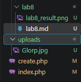
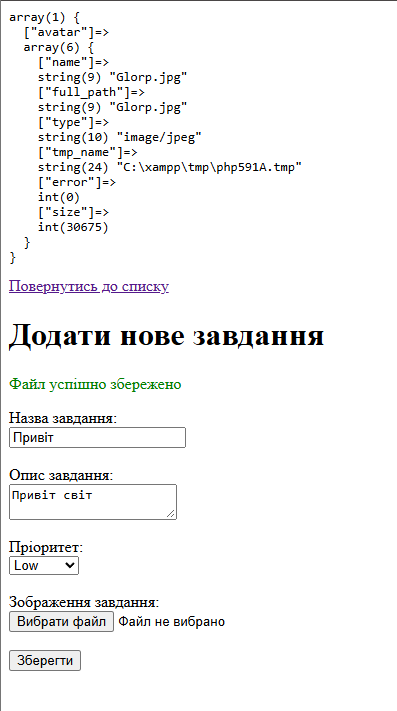

# Лабораторна робота №7

## 1. Фрагмент коду валідації

```php
<?php
if ($_SERVER['REQUEST_METHOD'] === 'POST') {

    if (isset($_FILES['avatar']) && $_FILES['avatar']['error'] === UPLOAD_ERR_OK) {
        $maxSize = 2 * 1024 * 1024;
        if ($_FILES['avatar']['size'] > $maxSize) {
            $errors[] = "Файл завеликий! Максимальний розмір — 2 МБ";
        }

        $fileName = $_FILES['avatar']['name'];
        $fileExtension = strtolower(pathinfo($fileName, PATHINFO_EXTENSION));
        $allowedExtensions = ['jpg', 'jpeg', 'png'];

        if (!in_array($fileExtension, $allowedExtensions)) {
            $errors[] = "Дозволені лише файли .jpg, .jpeg або .png";
        }
    } else {
        $errors[] = "Будь ласка, оберіть зображення для завантаження";
    }

    if (empty($errors)) {
        $fileTmpPath = $_FILES['avatar']['tmp_name'];
        $destination = 'uploads/' . $_FILES['avatar']['name'];

        if (move_uploaded_file($fileTmpPath, $destination)) {
            $successMessage = "Файл успішно збережено";
        } else {
            $errors[] = "Не вдалося перемістити завантажений файл";
        }
    }
}
```




## 3. Відповіді на контрольні запитання

* **Що таке enctype="multipart/form-data" і чому його обов’язково треба використовувати в тегу form для файлів?**
  Це спеціальний спосіб кодування даних у формі. 
  Його обов'язково треба ставити, бо за замовчуванням форма передає лише текст, а з цим атрибутом вона може передавати бінарні файли і картинки. Без нього браузер просто проігнорує файл

* **Які ключі завжди присутні в масиві для конкретного файлу в $_FILES? Опишіть призначення ключа tmp_name.**
  Завжди присутні ключі name, type, tmp_name, error та size. 
  Ключ tmp_name — це тимчасовий шлях, куди операційна система одразу кидає завантажений файл перед переміщенням його в постійну папку

* **Чому файли не зберігаються одразу у вашій папці проєкту після натискання Submit, а містяться в тимчасових директоріях операційної системи (tmp_name)?**
  Це зроблено заради безпеки
  Спочатку сервер приймає файл у захищену тимчасову директорію ОС, щоб скрипт перевірив його і тільки після успішної перевірки його можна перенести у свою папку через функцію move_uploaded_file()

* **Для чого ми використовуємо функцію move_uploaded_file()? Чому не можна просто скопіювати файл звичайною функцією copy() без перевірок безпеки?**
  Функція move_uploaded_file() спеціально створена для безпечного переміщення завантажених через форму файлів із тимчасової папки
  Звичайну функцію copy() використовувати не можна, бо вона не перевіряє, чи дійсно файл був завантажений через HTTP POST, що робить сайт вразливим

* **Які потенційні загрози несе дозвіл користувачам “завантажувати будь-що” на сервер (без перевірки розширення чи типу)?**
  Якщо дозволити завантажувати все підряд, зловмисник може завантажити шкідливий PHP-скрипт замість картинки. Потім він зможе запустити його через браузер і отримати повний контроль над сайтом або сервером