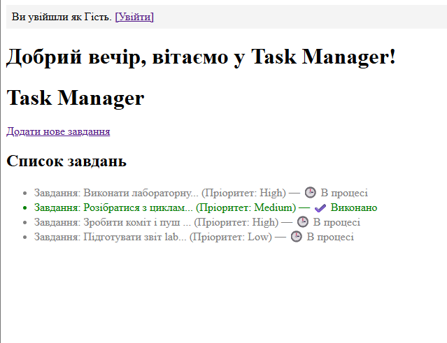
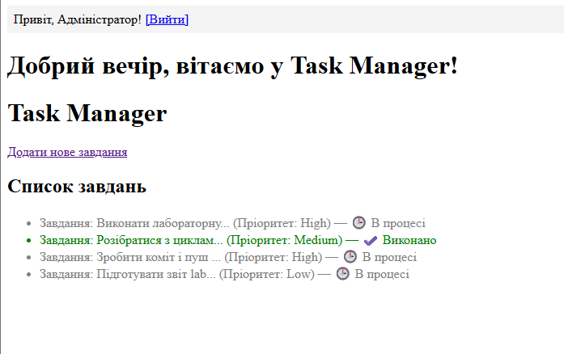

# Лабораторна робота №9

## 1. Фрагмент коду сторінки входу (login.php)

```php
<?php
session_start();

$error = '';

if ($_SERVER['REQUEST_METHOD'] === 'POST') {
    $username =$_POST['username'] ?? '';
    $password =$_POST['password'] ?? '';

    if ($username === 'admin' && $password === '12345') {$_SESSION['is_logged_in'] = true;
        $_SESSION['user_name'] = 'Адміністратор';
        
        header('Location: index.php');
        exit;
    } else {
        $error = "Невірний логін або пароль!";
    }
}
```

## 2. Фрагмент коду захисту сторінки (create.php)
```php
<?php
session_start();
if (!isset($_SESSION['is_logged_in']) \vert{}\vert{}$_SESSION['is_logged_in'] !== true) {
    header('Location: login.php');
    exit;
}
```




## 3. Відповіді на контрольні запитання

* **HTTP — це “stateless” протокол (без стану). Що це означає для розробника і чому сервер не впізнає одного й того ж користувача на різних сторінках без додаткових інструментів?**
  Це означає, що кожен запит від браузера до сервера є абсолютно новим і незалежним і сервер не запам'ятовує попередні дії користувача, тому при переході на нову сторінку він не впізнає того ж користувача

* **Яка різниця між Cookie та Сесією ($_SESSION)? Де фізично зберігаються дані змінних сесії (на клієнті в браузері чи на сервері)?**
  Cookie зберігаються у вигляді невеликих файлів у браузері користувача, а сесії зберігаються безпечно на сервері. В браузер клієнта передається лише унікальний ідентифікатор сесії

* **Що таке PHPSESSID і яку функцію виконує цей файл cookie?**
  Це спеціальний унікальний ідентифікатор сесії, який браузер зберігає у вигляді файлу cookie. Завдяки йому сервер розуміє, до якої саме сесії на сервері належить користувач при кожному запиті

* **Для чого необхідно викликати session_start() на самому-самому початку файлу, навіть до тегу <html> чи пробілів? Яку помилку ви отримаєте, якщо викличете це після HTML-коду (Headers already sent)?**
  Функція session_start() надсилає заголовки HTTP. Якщо перед цим вивести хоча б один символ чи пробіл, або тег <html>, PHP одразу почне передавати тіло сторінки і заголовки вже не можна буде змінити. У результаті з'явиться помилка Headers already sent

* **Що виконує функція header('Location: ...') і чому після перенаправлення обов’язково треба писати exit (або die)?**
  Функція header('Location: ...') дає браузеру команду перенаправити користувача на іншу сторінку
  exit необхідний для того, щоб зупинити подальше виконання поточного скрипту, оскільки без нього код нижче може продовжувати виконуватися в міру завантаження сторінки 